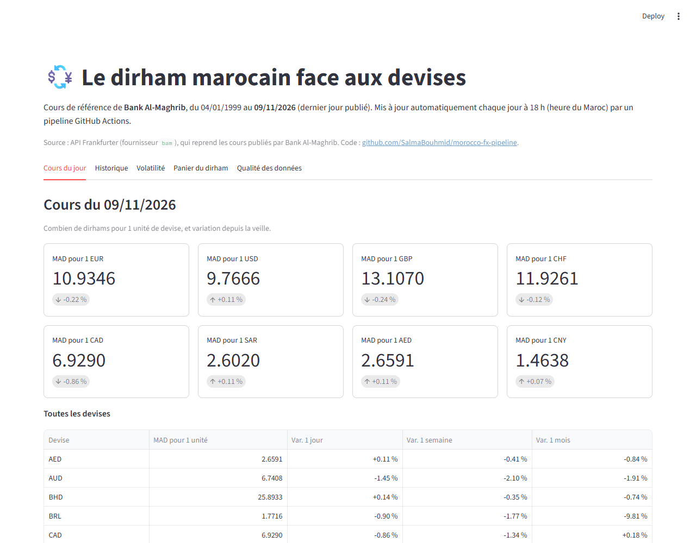
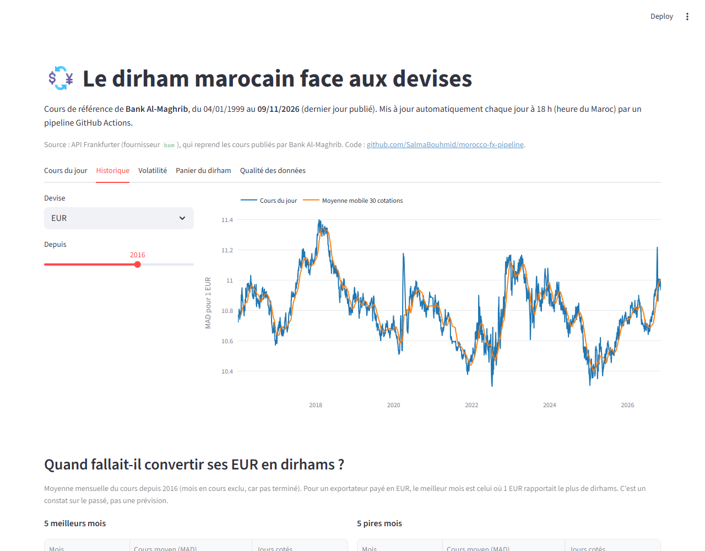
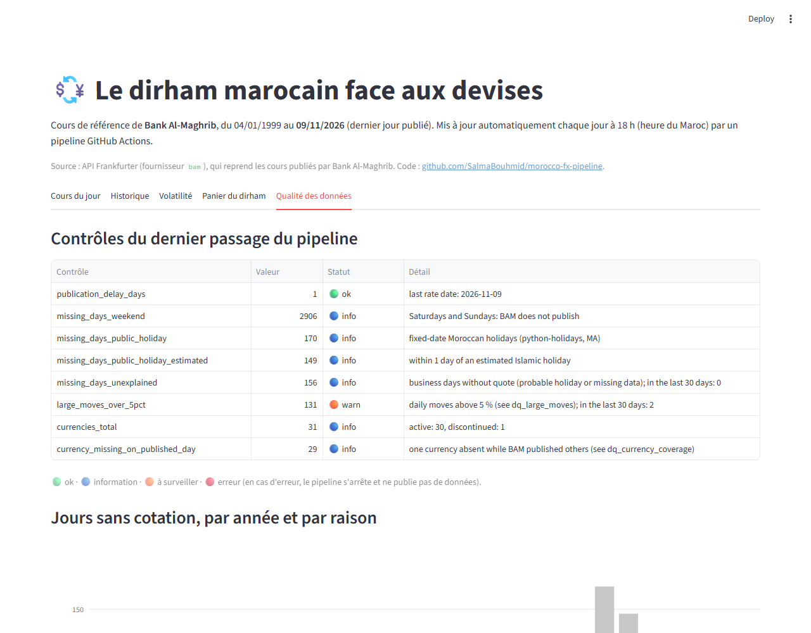
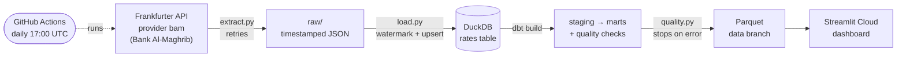
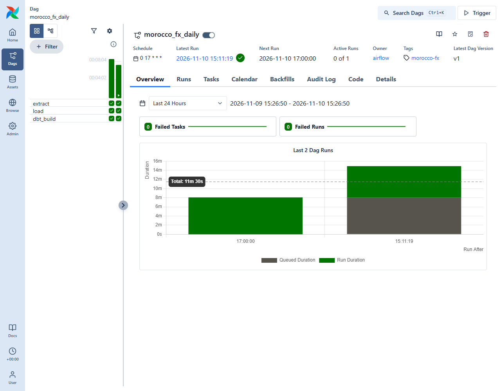

# Morocco FX Pipeline — the Moroccan dirham, updated every day

[](https://github.com/SalmaBouhmid/morocco-fx-pipeline/actions/workflows/ci.yml)
[](https://github.com/SalmaBouhmid/morocco-fx-pipeline/actions/workflows/daily.yml)

[🇫🇷 Français](README.md) · 🇬🇧 English

**Live dashboard: https://morocco-fx-pipeline-t3cjxagkdl6yretndgsuby.streamlit.app/** (in French)

A **data pipeline that runs by itself every day**: it collects the reference exchange rates of **Bank Al-Maghrib**
(Morocco's central bank: 30 currencies today, history since 1999-01-04), stores them without duplicates, checks their
quality, computes indicators with dbt and feeds a public dashboard.

**Why?** In Agadir and the Souss-Massa region, farm exporters sell in euros, hotels bill European customers and families
receive money from abroad: they all need to follow the dirham.



## What the dashboard shows

| Question | Tab |
|---|---|
| What is today's rate and its change (day, week, month)? | Cours du jour |
| When should an exporter have converted their euros? (best / worst months, seasonality) | Historique |
| Is the dirham stable against the euro and the dollar? (30-day volatility, moves > 5 %) | Volatilité |
| How does the dirham basket (60 % EUR / 40 % USD) move? | Panier du dirham |
| Is the data complete and up to date? | Qualité des données |

| History | Data quality |
|---|---|
|  |  |

## Architecture



Every day, **GitHub Actions** (free, no server):
1. **restores** yesterday's data from the `data` branch (Parquet files);
2. **downloads only the missing days** (watermark = last loaded date);
3. **loads without duplicates** (key `date + currency`, upsert);
4. runs **`dbt build`**: SQL models + tests;
5. runs the **quality gate**: on error the pipeline stops and publishes nothing;
6. **rewrites the `data` branch** as a single commit, so the repository does not grow over time.

The dashboard reads these Parquet files directly from GitHub.

## "Company" mode: Airflow + PostgreSQL in Docker

The **same code** also runs the way a company would run it: **Airflow** schedules the pipeline every day at 17:00 UTC
and the data goes into **PostgreSQL**. The DAG `morocco_fx_daily` chains 3 tasks, `extract → load → dbt_build`, with
2 retries (5 minutes apart) when a task fails.

```bash
cp .env.example .env              # then choose a password in .env (never committed)
docker compose up -d --build      # PostgreSQL + Airflow
```

Airflow UI: http://localhost:8080 · PostgreSQL from the host: `localhost:5433` (database `fx`).

First run (2026-11-10): 137,702 rows loaded since 1999, then the same dbt models as on DuckDB, with the same result
(61 tests: 60 passed, 1 warning on moves > 5 %). A second run added no duplicate.



## Engineering points

- **Incremental**: only the missing days are requested from the API.
- **Idempotent**: running the pipeline twice creates no duplicate (automated test).
- **Backfill**: one command reloads the whole history since 1999 in a single call.
- **Robust**: 4 attempts with growing waits (2, 4, 8 s) when the API fails; the raw answer is kept; a failure stops the
  pipeline (non-zero exit code) instead of going unnoticed.
- **Data quality**:
  - days without a rate are classified: weekend, public holiday, religious holiday (estimated date ±1 day) or
    unexplained business day;
  - a daily move above 5 % raises an alert;
  - a publication delay above 7 days blocks the pipeline.
- **Tested**: 46 pytest tests (no network: simulated API answers), 2 tests on PostgreSQL (in the container) and
  61 dbt tests; ruff and CI on every push.
- **Portable**: the same dbt models run on DuckDB (cloud) and PostgreSQL (company).

## Stack

Python (requests, pandas) · DuckDB · PostgreSQL · dbt (dbt-duckdb, dbt-postgres) · Airflow · Docker Compose ·
Parquet · GitHub Actions · Streamlit + Plotly

## Layout

```
morocco_fx/        extract.py (API + retries) · load.py (watermark, upsert, backfill)
                   load_postgres.py (same load into PostgreSQL)
                   quality.py (quality gate) · state.py (Parquet save / restore)
airflow/dags/      morocco_fx_daily.py (DAG: extract → load → dbt_build)
docker/            Airflow image (+ dbt-postgres) · database creation script
docker-compose.yml PostgreSQL + Airflow
transform/         dbt project: models/staging, models/marts, models/quality, seeds, tests
dashboard/         app.py (Streamlit) · fx_data.py (data access, tested)
scripts/           daily_run.sh (pipeline steps) · build_holiday_seed.py
.github/workflows/ ci.yml (checks) · daily.yml (daily run)
tests/             pytest tests
```

## Run it locally

```bash
pip install -r requirements.txt -r requirements-dbt.txt
python -m morocco_fx.load backfill          # whole history since 1999 (~15 s)
cd transform && dbt build && cd ..           # dbt models + tests
python -m morocco_fx.quality                 # quality gate (exit code 1 on error)
python -m morocco_fx.state export            # writes the Parquet files to data/export
FX_DATA_DIR=data/export streamlit run dashboard/app.py
```

On the following days, `python -m morocco_fx.load update` loads only the missing days.

## Data and sources

- **Rates**: [Frankfurter API](https://frankfurter.dev), provider `bam`. Frankfurter is an **aggregator**: it republishes
  the reference rates of [Bank Al-Maghrib](https://www.bkam.ma) (transfer rates). It is not a direct official source.
- **Currencies**: 30 quoted today; 31 over the whole history (the old Mauritanian ouguiya MRO was replaced by MRU in
  2018).
- **Dirham basket**: weights **60 % EUR / 40 % USD since 2015-04-13**, from Bank Al-Maghrib's
  [exchange rate regime history page](https://www.bkam.ma/fr/Trouvez-l-information-concernant/Reforme-du-regime-de-change/Historique-du-regime-de-change)
  (in French). That page does not give the central rate formula: the dashboard index is an **illustrative
  reconstruction** (weighted geometric mean, base 100 on 2015-04-13), not an official figure.
- **Public holidays**: the Python [`holidays`](https://pypi.org/project/holidays/) package (Morocco). Religious holiday
  dates are estimated there, so a ±1 day tolerance is applied.

## Roadmap

- [x] Extraction with retries and tests
- [x] Incremental, idempotent load and backfill
- [x] dbt models and tests
- [x] Data quality checks and report
- [x] Daily run with GitHub Actions
- [x] Streamlit dashboard online
- [x] "Company" mode: Docker Compose with Airflow and PostgreSQL (same code, dbt-postgres)

---

Built by **Salma Bouhmid**, DUT student (EST Agadir, Morocco).
