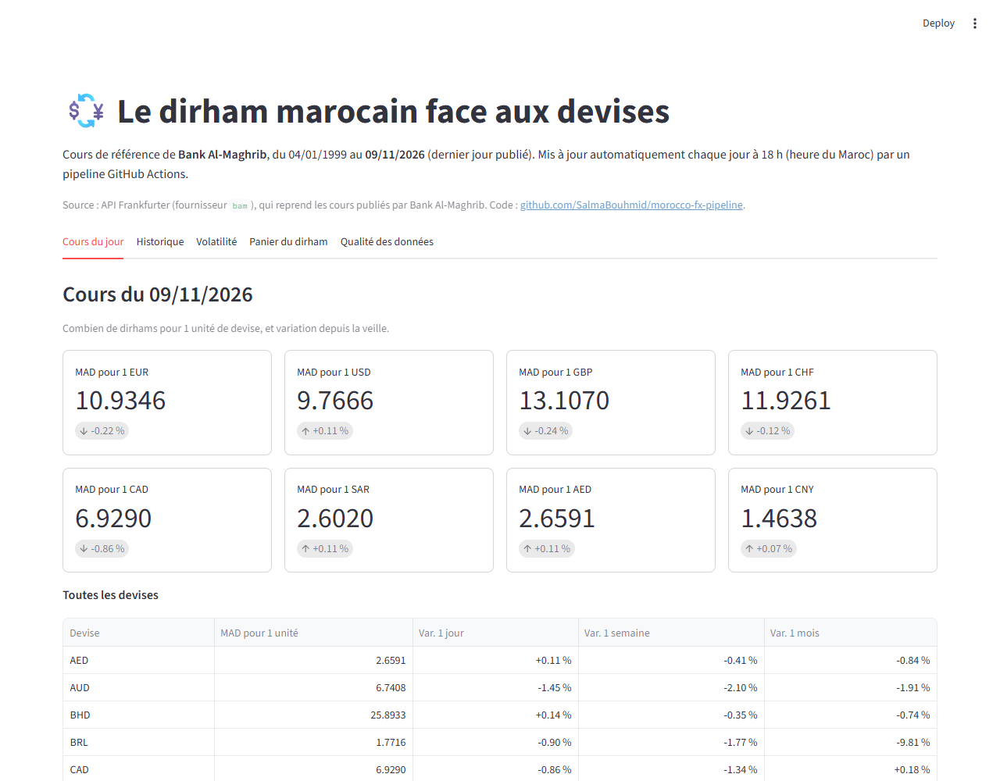
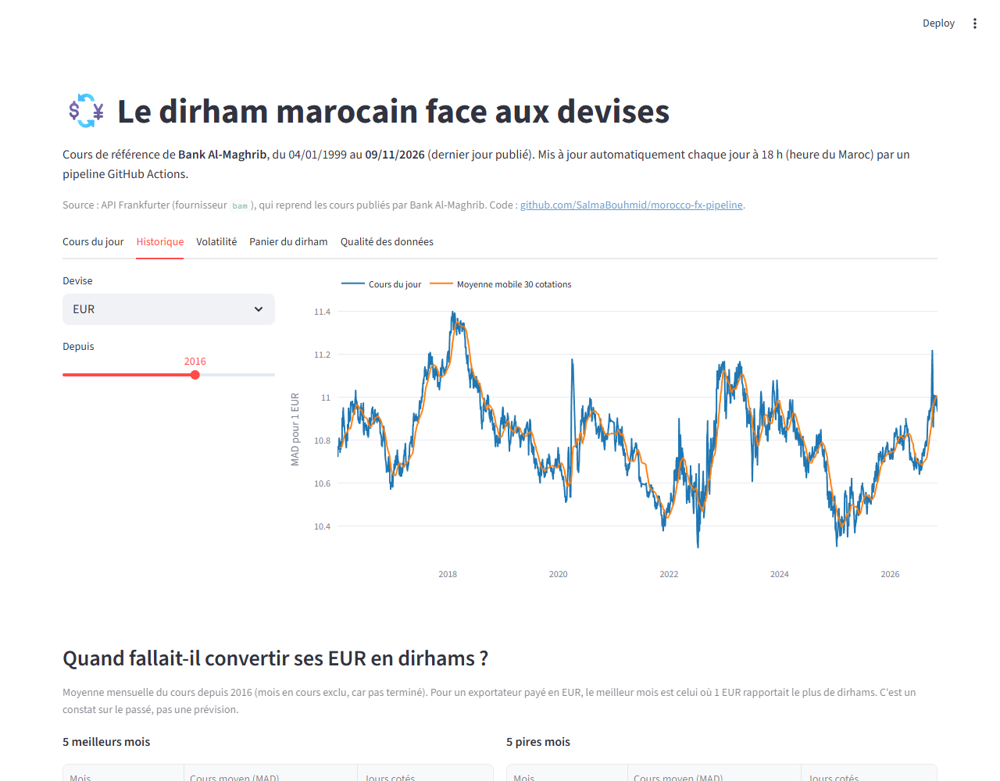
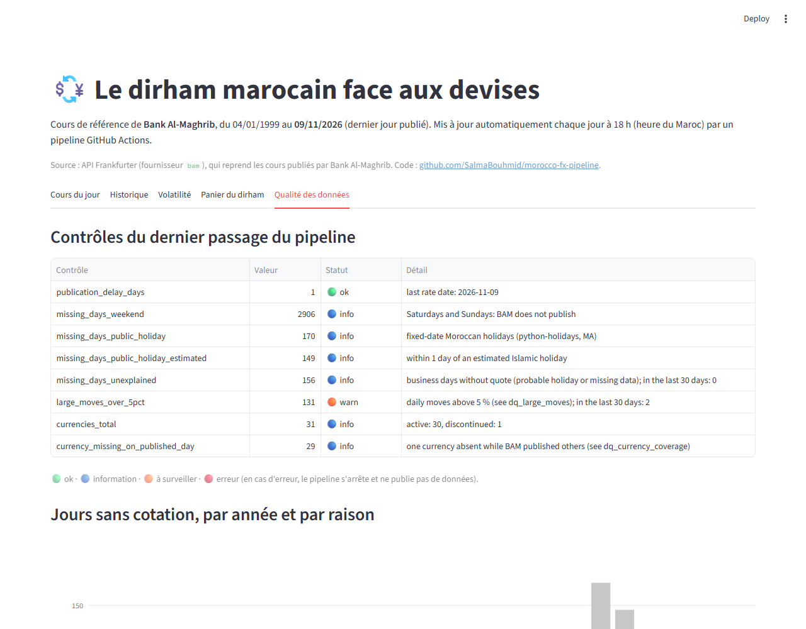
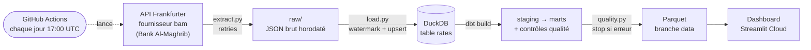

# Morocco FX Pipeline — le dirham marocain, mis à jour chaque jour

[](https://github.com/SalmaBouhmid/morocco-fx-pipeline/actions/workflows/ci.yml)
[](https://github.com/SalmaBouhmid/morocco-fx-pipeline/actions/workflows/daily.yml)

🇫🇷 Français · [🇬🇧 English](README.en.md)

**Dashboard en ligne : https://morocco-fx-pipeline-t3cjxagkdl6yretndgsuby.streamlit.app/**

Un **pipeline de données qui tourne tout seul chaque jour** : il collecte les cours de change de référence de
**Bank Al-Maghrib** (30 devises aujourd'hui, historique depuis le 04/01/1999), les stocke sans doublon, contrôle leur
qualité, calcule des indicateurs avec dbt et alimente un dashboard public.

**Pourquoi ?** À Agadir et dans le Souss-Massa, les exportateurs agricoles vendent en euros, les hôtels facturent des
clients européens et les familles reçoivent des transferts de l'étranger : tous ont besoin de suivre le dirham.



## Ce que montre le dashboard

| Question | Onglet |
|---|---|
| Quel est le cours du jour et sa variation (jour, semaine, mois) ? | Cours du jour |
| Quand un exportateur aurait-il dû convertir ses euros ? (meilleurs / pires mois, saisonnalité) | Historique |
| Le dirham est-il stable face à l'euro et au dollar ? (volatilité 30 jours, variations > 5 %) | Volatilité |
| Comment évolue le panier du dirham (60 % EUR / 40 % USD) ? | Panier du dirham |
| Les données sont-elles complètes et à jour ? | Qualité des données |

| Historique | Qualité des données |
|---|---|
|  |  |

## Architecture



Chaque jour, **GitHub Actions** (gratuit, sans serveur) :
1. **restaure** les données de la veille depuis la branche `data` (fichiers Parquet) ;
2. **télécharge seulement les jours manquants** (watermark = dernière date chargée) ;
3. **charge sans doublon** (clé `date + devise`, upsert) ;
4. lance **`dbt build`** : modèles SQL + tests ;
5. passe le **contrôle qualité** : en cas d'erreur, le pipeline s'arrête et ne publie rien ;
6. **réécrit la branche `data`** en un seul commit : le dépôt ne grossit pas avec le temps.

Le dashboard lit ces fichiers Parquet directement sur GitHub.

## Points d'ingénierie

- **Incrémental** : seuls les jours manquants sont demandés à l'API.
- **Idempotent** : relancer le pipeline ne crée aucun doublon (testé automatiquement).
- **Backfill** : une commande recharge tout l'historique depuis 1999 en un seul appel.
- **Robuste** : 4 tentatives avec attente croissante (2, 4, 8 s) si l'API ne répond pas ; la réponse brute est gardée ;
  un échec arrête le pipeline (code de sortie ≠ 0) au lieu de passer inaperçu.
- **Qualité** :
  - les jours sans cours sont classés : week-end, jour férié, fête religieuse (date estimée ±1 jour) ou jour ouvré
    inexpliqué ;
  - une variation de plus de 5 % en un jour déclenche une alerte ;
  - un retard de publication de plus de 7 jours bloque le pipeline.
- **Testé** : 46 tests pytest (sans réseau : réponses de l'API simulées) et 61 tests dbt ; ruff et CI à chaque push.

## Stack

Python (requests, pandas) · DuckDB · dbt (dbt-duckdb) · Parquet · GitHub Actions · Streamlit + Plotly

## Structure

```
morocco_fx/        extract.py (API + retries) · load.py (watermark, upsert, backfill)
                   quality.py (porte qualité) · state.py (sauvegarde / restauration Parquet)
transform/         projet dbt : models/staging, models/marts, models/quality, seeds, tests
dashboard/         app.py (Streamlit) · fx_data.py (lecture des données, testée)
scripts/           daily_run.sh (les étapes du pipeline) · build_holiday_seed.py
.github/workflows/ ci.yml (vérifications) · daily.yml (exécution quotidienne)
tests/             tests pytest
```

## Lancer en local

```bash
pip install -r requirements.txt -r requirements-dbt.txt
python -m morocco_fx.load backfill          # tout l'historique depuis 1999 (~15 s)
cd transform && dbt build && cd ..           # modèles + tests dbt
python -m morocco_fx.quality                 # contrôle qualité (code 1 si erreur)
python -m morocco_fx.state export            # écrit les Parquet dans data/export
FX_DATA_DIR=data/export streamlit run dashboard/app.py
```

Les jours suivants, `python -m morocco_fx.load update` ne charge que les jours manquants.

## Données et sources

- **Cours** : [API Frankfurter](https://frankfurter.dev), fournisseur `bam`. Frankfurter est un **agrégateur** : il
  reprend les cours de référence publiés par [Bank Al-Maghrib](https://www.bkam.ma) (cours de virement). Ce n'est pas
  une source officielle directe.
- **Devises** : 30 devises cotées aujourd'hui ; 31 sur tout l'historique (l'ancienne ouguiya mauritanienne MRO a été
  remplacée par MRU en 2018).
- **Panier du dirham** : pondérations **60 % EUR / 40 % USD depuis le 13/04/2015**, d'après la page
  [Historique du régime de change](https://www.bkam.ma/fr/Trouvez-l-information-concernant/Reforme-du-regime-de-change/Historique-du-regime-de-change)
  de Bank Al-Maghrib. Cette page ne donne pas la formule du cours central : l'indice du dashboard est une
  **reconstruction illustrative** (moyenne géométrique pondérée, base 100 le 13/04/2015), pas un chiffre officiel.
- **Jours fériés** : paquet Python [`holidays`](https://pypi.org/project/holidays/) (Maroc). Les dates des fêtes
  religieuses y sont estimées : une tolérance de ±1 jour est appliquée.

## Feuille de route

- [x] Extraction avec retries et tests
- [x] Chargement incrémental et idempotent, backfill
- [x] Modèles et tests dbt
- [x] Contrôles qualité et rapport
- [x] Exécution quotidienne par GitHub Actions
- [x] Dashboard Streamlit en ligne
- [ ] Mode « entreprise » : Docker Compose avec Airflow et PostgreSQL (même code, dbt-postgres)

---

Projet réalisé par **Salma Bouhmid**, étudiante en DUT (EST Agadir).
